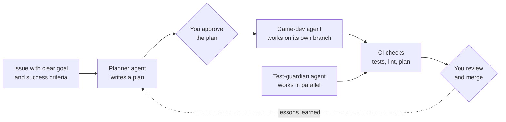
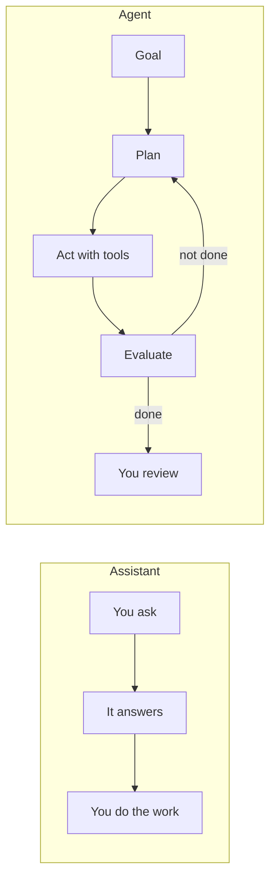
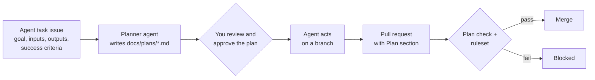
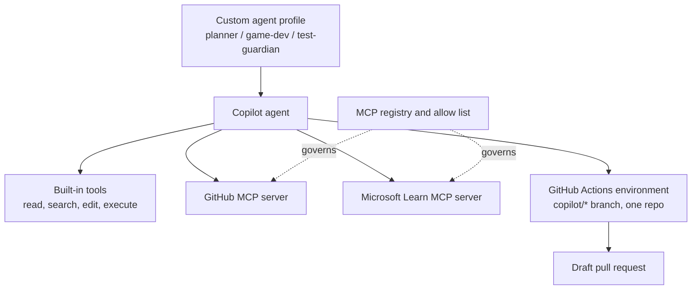
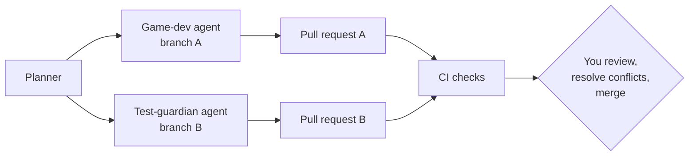
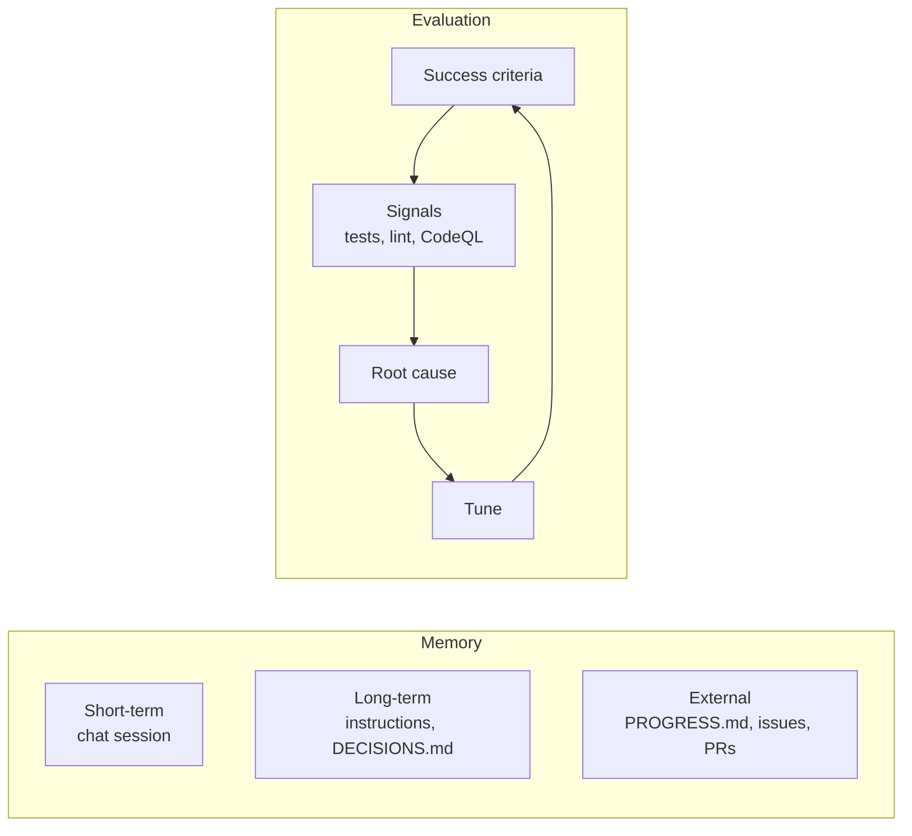
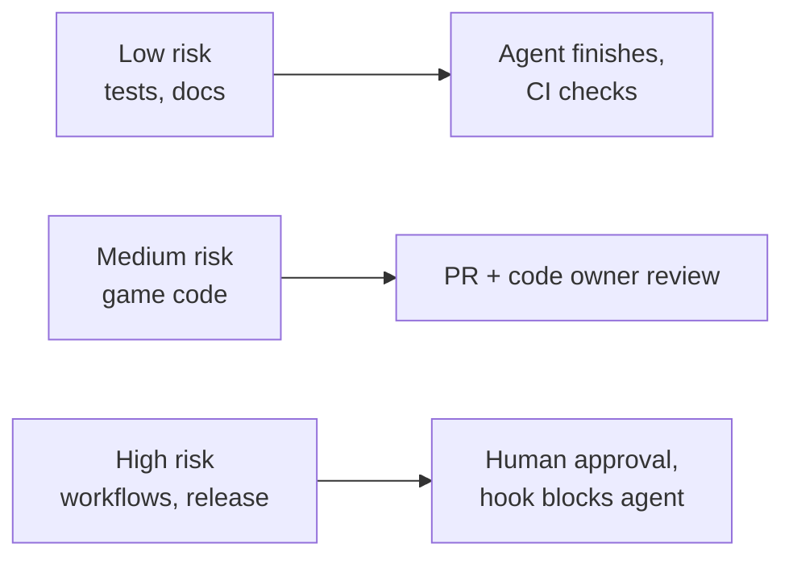

# GH-600 Hands-on Lab: Castle Busters

**Build, test and ship a small game with a team of GitHub Copilot agents, using GitHub.com and VS Code.**

Welcome! In this lab you play the role of a developer at a small games studio. The studio is building **Castle Busters**: you pick an angle and a power, launch a boulder from a catapult and knock down castle blocks, a lot like Angry Birds. The game is written in Python because it is easy to read, needs nothing extra to run (the game window uses `turtle`, which comes with Python) and its rules can be tested with pytest.

Over the lab, Copilot agents will plan, build, test, review and release new features for the game. You stay in charge: you approve plans, review pull requests and approve the release. GitHub keeps a record of everything.

| | |
|---|---|
| **Course** | GH-600: Developing in Agentic AI Systems |
| **Time** | About 75 minutes |
| **Tools** | GitHub.com and VS Code |
| **You start with** | An empty repository |
| **You finish with** | A tested game, three custom agents, MCP servers, guardrails and an approved release |

---

## Contents

- [How this guide works](#how-this-guide-works)
- [Before you start](#before-you-start)
- [Lab 0: From an empty repo to a playable game](#lab-0-from-an-empty-repo-to-a-playable-game-8-min)
- [Part 1: Assistant vs agent](#part-1-assistant-vs-agent-5-min)
- [Part 2: Plan before you act](#part-2-plan-before-you-act-12-min)
- [Part 3: Tools, MCP and the cloud agent](#part-3-tools-mcp-and-the-cloud-agent-15-min)
- [Part 4: A team of agents](#part-4-a-team-of-agents-10-min)
- [Part 5: Memory, state and evaluation](#part-5-memory-state-and-evaluation-10-min)
- [Part 6: Guardrails and release](#part-6-guardrails-and-release-12-min)
- [Wrap-up: what you practised](#wrap-up-what-you-practised)
- [Self-check](#self-check)
- [Troubleshooting](#troubleshooting)

---

## How this guide works

Each part starts with a short **Concept** note and a diagram, then gives numbered steps. You will see three kinds of boxes:

> **Check:** what you should see on screen when the step worked.

> **Why it matters:** the GH-600 idea behind the step.

> **Tip:** a shortcut or a common problem to avoid.

Prompts are in grey code boxes. Select the copy icon in the top-right corner of the box and paste the prompt into Copilot Chat (or into GitHub.com where the step says so).

All the files you need are in the **student starter pack** zip (`GH-600-Castle-Busters-Student-Pack.zip`). Each folder in the zip is named after the step that uses it, for example `step-2.2-sdlc`. You never have to type a file by hand.

### The story of the lab



A product owner writes an issue with clear inputs, outputs and success criteria. A **planner** agent writes a plan, you approve it, a **game-dev** agent builds it on its own branch, CI checks it, and you review and merge. A **test-guardian** agent works in parallel. GitHub is the **system of record** (issues, plans, commits, pull requests, logs) and the **control plane** (rulesets, CODEOWNERS, environments, hooks).

### Lab timeline

| Time (min) | Part | GH-600 skill area |
|---|---|---|
| 0-8 | Lab 0: Empty repo to playable game | Setup |
| 8-13 | Part 1: Assistant vs agent | Foundations |
| 13-25 | Part 2: Plan before you act | Prepare agent architecture and SDLC processes |
| 25-40 | Part 3: Tools, MCP and the cloud agent | Implement tool use and environment interaction |
| 40-50 | Part 4: A team of agents | Orchestrate multi-agent coordination |
| 50-60 | Part 5: Memory, state and evaluation | Manage memory, state, and execution; Perform evaluation, error analysis, and tuning |
| 60-72 | Part 6: Guardrails and release | Implement guardrails and accountability |
| 72-75 | Wrap-up | All |

> **Tip:** Cloud agent sessions take about 5 to 15 minutes. When a step says "start this now", start it and carry on with the next step while the agent works. You come back to review it later.

---

## Before you start

| You need | Why | How to check |
|---|---|---|
| A GitHub account with a paid Copilot plan (Pro, Pro+, Business or Enterprise) | The Copilot cloud agent needs a paid plan | Open github.com/settings/copilot and look at your plan |
| Business or Enterprise users: the cloud agent and MCP servers enabled by your admin | Organization policies can switch them off | Ask your admin, or try assigning an issue to Copilot |
| VS Code (latest) with the GitHub Copilot Chat extension, signed in to GitHub | Agent mode, custom agents and MCP | The Chat view opens with **Ctrl+Alt+I** (macOS: **Ctrl+Cmd+I**) |
| Python 3.11 or newer, and Git | Run the game and tests | Run `python --version` and `git --version` in a terminal |
| The student starter pack, unzipped | Copy files instead of typing them | A folder named `castle-busters-student-pack` with `step-...` folders inside |

**Get the starter pack:** in the class repository shared by your trainer, open `GH-600-Castle-Busters-Student-Pack.zip`, select **Download raw file** (the download icon), and unzip it on your desktop.

> **Tip:** Folders whose names start with a dot (`.github`, `.vscode`) are hidden by default. On Windows: File Explorer, **View**, **Show**, **Hidden items**. On macOS: press **Cmd+Shift+.** in Finder.

**How to add a step's files.** Whenever a step says "add the files from `step-X`": open that folder, select everything **inside** it, copy, and paste into the root of your cloned `castle-busters` folder. Choose **merge** or **replace** if asked. The files land in the right sub-folders automatically.

---

## Lab 0: From an empty repo to a playable game (8 min)

**Concept.** Agents need a real codebase with tests, because tests are how an agent (and you) can prove its work. You start from an empty repository so you can see that everything an agent uses later lives in the repository.

### Step 0.1: Create an empty repository on GitHub.com

1. Go to **github.com**. In the top-right corner select **+**, then **New repository**.
2. Fill in the form:

| Field | Value |
|---|---|
| Owner | Your own account |
| Repository name | `castle-busters` |
| Description | Castle Busters - GH-600 agentic AI lab |
| Visibility | **Public** (rulesets and environments then work on any plan) |
| Add README | Off |
| Add .gitignore | No .gitignore |
| Add license | No license |

3. Select **Create repository**. Copy the HTTPS URL shown on the next page.

> **Check:** an empty repository page with the heading "Quick setup".

### Step 0.2: Clone it in VS Code

1. Open VS Code. Press **Ctrl+Shift+P** (macOS: **Cmd+Shift+P**), type `Git: Clone` and press **Enter**.
2. Paste the URL, choose a folder (for example Documents), then select **Open** when VS Code asks.
3. Select the **Accounts** icon (bottom-left) and confirm your GitHub account is signed in.
4. Open the Chat view with **Ctrl+Alt+I**.

### Step 0.3: Add the game code

Choose **one** option. Option A is the quickest and gives exactly the results shown in this guide.

**Option A (recommended): copy the starter files.** Add the files from **`step-0.3-game`** into your cloned folder. You now have `castle_busters/`, `tests/`, `pyproject.toml`, `requirements-dev.txt`, `README.md` and `.gitignore`.

**Option B: let Agent mode generate the game.** In the Chat view set the mode picker to **Agent** and send:

**Prompt L0**

```text
Create a small Python 3.11 game called Castle Busters in this empty folder (a catapult-and-castle game, like Angry Birds). Keep game rules separate from drawing.
- castle_busters/physics.py: GRAVITY = 9.8; dataclass Shot(angle_deg, power); validate_shot (0 < angle < 90, 0 < power <= 100, else ValueError); position_at(shot, t); flight_time(shot); landing_distance(shot) rounded to 2 decimals; trajectory(shot, steps=50).
- castle_busters/castle.py: BLOCK_POINTS wood 10, stone 25, tower 50; dataclass Block(kind, x, width=4.0, standing=True) with covers(x); Castle with hit(landing_x) returning the blocks knocked down, and a destroyed property; level_one() with wood at 150, stone at 158, tower at 166.
- castle_busters/scoring.py: score_hit(blocks) and final_score(points, shots_used) with a 5-point penalty for every shot after the first, never below zero, ValueError if shots_used < 1.
- castle_busters/game.py: a turtle window that asks for angle and power, draws the castle and the flight path, maximum 5 boulders.
- pytest tests in tests/, requirements-dev.txt (pytest, ruff), pyproject.toml with pythonpath ["."], README.md and a Python .gitignore.
Then run python -m pytest -q and show me the result.
```

> **Tip:** With Option B your code may differ a little from this guide. Later steps still work, but test counts and hit distances may not match exactly.

### Step 0.4: Run the tests and play

Open a terminal in VS Code (**Ctrl+`**) and run the commands for your system.

Windows:

```text
python -m venv .venv
.venv\Scripts\activate
pip install -r requirements-dev.txt
python -m pytest -q
python -m castle_busters.game
```

macOS or Linux:

```text
python3 -m venv .venv
source .venv/bin/activate
pip install -r requirements-dev.txt
python -m pytest -q
python -m castle_busters.game
```

> **Check:** `13 passed`, then a Castle Busters window. Enter angle **45** and power **38.5** to knock down the wooden block. Try power **40**: it just misses.

### Step 0.5: Commit and push

1. Open the **Source Control** view (**Ctrl+Shift+G**).
2. Type the message `Castle Busters level 1`, select **Commit** (choose **Yes** if asked to stage all changes).
3. Select **Sync Changes** (or **Publish Branch**).
4. Refresh your repository page on GitHub.com.

> **Why it matters:** everything an agent needs is now in GitHub: code, tests and history. From here on, GitHub is your system of record.

---

## Part 1: Assistant vs agent (5 min)

**Concept.** An **assistant** answers one prompt and you do the work. An **agent** pursues a goal: it plans, acts with tools (edits files, runs the terminal) and evaluates the result, looping until the goal is met or it needs your help. Humans stay in the loop to approve important steps.



### Step 1.1: Ask mode (assistant)

In the Chat view set the mode picker to **Ask** and send:

**Prompt 1A**

```text
Explain in 3 short bullet points how landing_distance in castle_busters/physics.py works.
```

> **Check:** an explanation only. No files change.

### Step 1.2: Agent mode (agent)

Switch the mode picker to **Agent** and send:

**Prompt 1B**

```text
Goal: add a function max_range(power) to castle_busters/physics.py that returns the longest possible landing distance for a given power.
First show me a short plan (files, steps, tests). Then implement it, add a pytest test, run python -m pytest -q and tell me the result.
```

> **Check:** Copilot writes a short plan, edits two files and asks permission to run a terminal command. Select **Allow**. It runs the tests and reports `14 passed`. Changed files show **Keep** and **Undo** controls.

> **Why it matters:** plan, act, evaluate. Notice the human checkpoints: you approved the terminal command and you decide whether to keep the edits.

> **Tip:** If the agent asks to run something you did not expect, select **Skip**. That is human-in-the-loop in action.

### Step 1.3: Keep and commit

Select **Keep**, then commit with the message `Add max_range (agent mode)` and select **Sync Changes**.

---

## Part 2: Plan before you act (12 min)

**Concept.** Good agents have clear inputs, outputs and success criteria, and their planning is separate from their actions. The plan becomes a file you can inspect and approve. GitHub controls (a required plan check, a ruleset and CODEOWNERS) stop changes without a plan from being merged.



### Step 2.1: Give every agent the house rules

Add the files from **`step-2.1-house-rules`**:

| File | What it does |
|---|---|
| `.github/copilot-instructions.md` | Rules every Copilot agent reads: build commands, plan first, do not touch workflows, read DECISIONS.md |
| `.github/instructions/tests.instructions.md` | Extra rules that apply only to files under `tests/` (see its `applyTo` line) |

Open `.github/copilot-instructions.md` and read the numbered rules. You will see rule 5 again in Part 5.

### Step 2.2: Add the SDLC scaffolding

Add the files from **`step-2.2-sdlc`**:

| File | What it does |
|---|---|
| `.github/ISSUE_TEMPLATE/agent-task.yml` | An issue form that asks for Goal, Inputs, Outputs, Success criteria and Risk |
| `.github/pull_request_template.md` | Every pull request starts with Plan and Success criteria sections |
| `.github/CODEOWNERS` | Routes reviews by path |
| `.github/workflows/plan-check.yml` | Fails any pull request whose description has no Plan or Success criteria |
| `.github/agents/planner.agent.md` | A custom agent that only writes plans (tools: read, search, edit) |
| `docs/agent-state/DECISIONS.md`, `docs/agent-state/PROGRESS.md` | Shared memory for agents, used in Part 5 |
| `docs/plans/.gitkeep` | An empty file so the plans folder exists |

1. Open `.github/CODEOWNERS` and replace every `@YOUR-GITHUB-USERNAME` with **your** GitHub username (keep the `@`).
2. Commit with the message `Add agent SDLC scaffolding` and sync.

### Step 2.3: Write the first agent task on GitHub.com

1. In your repository on GitHub.com select **Issues**, **New issue**, then the **Agent task** template.
2. Fill in the form:

| Field | Value |
|---|---|
| Title | [Agent task]: Add wind to Castle Busters |
| Goal | Each shot can have wind (metres per second, negative means headwind). Wind pushes the boulder sideways so players must adjust their aim. |
| Inputs | castle_busters/physics.py, tests/test_physics.py, decision D2 in docs/agent-state/DECISIONS.md (gravity stays 9.8) |
| Expected outputs | Shot gets an optional wind field (default 0); position_at adds wind drift; new tests; plan linked in the PR |
| Success criteria | All existing tests still pass; new tests for headwind, tailwind and zero wind; ruff clean; wind 0 gives exactly today's results |
| Risk level | Medium - pull request review required (game code) |
| Out of scope | game.py drawing, scoring.py, anything in .github/workflows |

3. Select **Create**. This is issue **#1**.

> **Why it matters:** these boxes are the agent's contract: inputs, outputs and measurable success criteria. Vague issues produce vague agent work.

### Step 2.4: Ask the planner agent for a structured plan

1. In VS Code Chat, open the agent picker and select **planner**. It appears because of `.github/agents/planner.agent.md`.
2. Send:

**Prompt 2A**

```text
Create the plan for GitHub issue #1 "Add wind to Castle Busters".
Goal: wind in metres per second (negative = headwind) adds horizontal drift: x = power*cos(angle)*t + wind*t. Wind 0 must give exactly today's results. Gravity must stay 9.8 (decision D2).
Write docs/plans/wind.md using your required headings. Do not change any other file.
```

> **Check:** one new file, `docs/plans/wind.md`, with Goal, Inputs, Steps, Tests, Success criteria, Risks and Hand-off. The planner cannot run commands because its tool list has no `execute`.

3. Read the plan. Edit anything you disagree with. This is **your** validation step.
4. Commit with the message `Plan for issue #1 approved by <your name>` and sync. The commit is your approval record.

### Step 2.5: Protect main with a ruleset

1. In your repository select **Settings**, **Rules**, **Rulesets**, **New ruleset**, **New branch ruleset**.
2. Fill in the form:

| Field | Value |
|---|---|
| Ruleset name | `protect-main` |
| Enforcement status | Active |
| Bypass list | **Add bypass**, select **Repository admin** (so you can still push setup files today; you remove it in Part 6) |
| Target branches | **Add target**, **Include default branch** |
| Restrict deletions | Ticked |
| Require a pull request before merging | Ticked; Required approvals **0** (you are working alone; real teams use 1 or more) |
| Require status checks to pass | Ticked; add the check `plan-check` (add `test` too after CI has run once in Part 3) |
| Block force pushes | Ticked |

3. Select **Create**.

> **Tip:** A status check only appears in the search list after it has run at least once. If `plan-check` is not listed yet, do Step 2.6 first, then come back and add it.

> **Tip:** Because you are on the bypass list, VS Code may still let you push straight to main. That is expected until Part 6.

### Step 2.6: Prove the gate works

1. On GitHub.com open `README.md`, select the pencil (**Edit**) and add a line such as `Now with agents!`.
2. Select **Commit changes**, choose **Create a new branch for this commit and start a pull request**, then **Propose changes**.
3. Delete everything in the pull request description box and select **Create pull request**.

> **Check:** the **Plan check** fails with "Missing '## Plan' section". Merging is blocked.

4. Edit the pull request description: paste the text from `.github/pull_request_template.md` (it has `## Plan` and `## Success criteria`), fill in a line under each heading and save.

> **Check:** the Plan check turns green. Merge with **Squash and merge**.

5. Back in VS Code select **Sync Changes** to pull the merged change.

> **Why it matters:** you did not ask the agent to be careful. You made "no plan, no merge" a technical control.

---

## Part 3: Tools, MCP and the cloud agent (15 min)

**Concept.** Tools turn a model into an agent, so every tool is a permission decision. **Custom agents** limit which tools each role can use. **MCP servers** plug in extra tools in a standard way. The **cloud agent** runs in a short-lived GitHub Actions environment, on its own branch, scoped to one repository.



### Step 3.1: Add the specialist agents and the agent environment

Add the files from **`step-3.1-agents-and-ci`**, commit with the message `Add agents, CI and setup steps` and sync:

| File | What it does |
|---|---|
| `.github/agents/game-dev.agent.md` | Builds approved plans. Tools: read, search, edit, execute |
| `.github/agents/test-guardian.agent.md` | Writes tests only, never game code |
| `.github/workflows/copilot-setup-steps.yml` | Pre-installs Python, pytest and ruff for the cloud agent. The job must be named `copilot-setup-steps` |
| `.github/workflows/ci.yml` | Tests and lint on every pull request, read-only token, retries, concurrency and an evidence artifact |

> **Check:** on the **Actions** tab, "Copilot Setup Steps" and "CI - tests and evaluation" run and turn green.

> **Why it matters:** compare the three agents' `tools:` lists. The planner can read and edit but cannot run commands. The test-guardian may only touch tests. That is least privilege for agents.

### Step 3.2: Hand issue #1 to the Copilot cloud agent (start this now)

1. On GitHub.com open issue **#1**. In the right sidebar, under **Assignees**, select **Copilot**.
2. In the dialog that opens fill in:

| Field | Value |
|---|---|
| Repository | castle-busters |
| Base branch | main |
| Agent | **game-dev** |
| Optional prompt | Follow the approved plan in docs/plans/wind.md. Put it under ## Plan in the PR description and paste the test results. |

3. Select **Assign**.

> **Check:** Copilot adds an eyes reaction to the issue, then a draft pull request appears on a branch that starts with `copilot/`. Open it and select **View session** to watch the agent think, edit and run tests.

> **Why it matters:** branch-based scope. The agent can only push to its own `copilot/` branch, never to main. It opens a pull request and waits for you.

> **Tip:** When the agent pushes, GitHub may show **Approve and run workflows** on the pull request before CI runs. Select it. That is another human checkpoint.

### Step 3.3: Add MCP servers in VS Code (while the agent works)

1. Press **Ctrl+Shift+P** and run **MCP: Add Server**.
2. Choose **HTTP**, enter `https://api.githubcopilot.com/mcp/`, name it `github` and choose **Workspace** so it is saved in the repo. Sign in with GitHub when asked.
3. Repeat with the URL `https://learn.microsoft.com/api/mcp` and the name `microsoft-learn` (no sign-in needed).
4. In the Chat view select the **Configure Tools** (tools) button. Expand the `github` server and untick its write tools (for example the create or update tools). This is tool permission in action.

> **Tip:** If the guided flow looks different in your VS Code version, add `.vscode/mcp.json` from **`step-3.3-mcp`** instead, open it and select **Start** above each server.

Set the mode picker to **Agent** and send:

**Prompt 3A**

```text
Using the GitHub MCP server, list the open issues in my castle-busters repository and summarise issue #1 in two lines. Do not change anything.
```

> **Check:** Copilot asks you to approve a tool call to the `github` server, then shows the summary of issue #1.

**Prompt 3B**

```text
Use the microsoft-learn tools to find the official Microsoft Learn study guide for exam GH-600 and give me its link and the six skill areas.
```

> **Check:** a tool call to `microsoft-learn`, then the study guide link and six skill areas.

### Step 3.4: Give the cloud agent an MCP server (repository level)

1. In your repository select **Settings**. Under **Code, planning, and automation** select **Copilot**, then **MCP servers**.
2. In **MCP configuration** paste the JSON below (it is also in `step-3.3-mcp/docs/repo-mcp-config.json`), then select **Save MCP configuration**.

```json
{
  "mcpServers": {
    "microsoft-learn": {
      "type": "http",
      "url": "https://learn.microsoft.com/api/mcp",
      "tools": ["microsoft_docs_search"]
    }
  }
}
```

> **Why it matters:** the GitHub and Playwright MCP servers are on by default for the cloud agent. You add Microsoft Learn and allow-list exactly one read-only tool, because the cloud agent uses MCP tools without asking you first.

### Step 3.5: MCP registry and allow list (read only)

These are organization or enterprise settings, so you will normally only look at them. Your trainer may show them on screen.

- **Organization:** **Settings**, **Copilot**, **Policies**. Keep **MCP servers in Copilot** enabled, enter an **MCP Registry URL**, then set **Restrict MCP access to registry servers** to **Registry only**.
- **Enterprise:** **AI controls**, **MCP**, same two settings.

> **Why it matters:** a registry and an allow list let an organization decide which MCP servers any agent may use. The registry-based restriction is in public preview.

### Step 3.6 (optional, 2 min): An agent started from CI, with retries and escalation

Add the file from **`step-3.6-agent-dispatch`** and open `.github/workflows/agent-dispatch.yml`. Read how it works:

1. When someone adds the label `agent-ready` to an issue, the workflow asks Copilot to start a cloud agent task.
2. It retries three times, waiting longer each time.
3. If it still fails, it posts a comment that escalates to a human.

It needs a repository secret named `COPILOT_AGENT_PAT` (a personal access token), so you only need to read it today. Commit it if you like; without the secret it will simply escalate.

### Step 3.7: Review the agent's pull request (when the session finishes)

Open the draft pull request for issue #1 and check:

- [ ] The **Plan** section links `docs/plans/wind.md`.
- [ ] **Files changed** only touches `physics.py`, tests and `PROGRESS.md`.
- [ ] The checks (CI and Plan check) are green.
- [ ] The description names the custom agent used.

Leave it open. You evaluate and merge it in Part 5.

---

## Part 4: A team of agents (10 min)

**Concept.** Split work across specialist agents with one job each, coordinate them with an orchestration pattern (sequential or parallel), and isolate them so they do not trip over each other. Issues, branches, pull requests, checks and logs are how agents hand off work and how humans audit them.



### Step 4.1: Create two independent tasks

On GitHub.com create two issues with the **Agent task** form:

| Field | Issue #2 | Issue #3 |
|---|---|---|
| Title | [Agent task]: One-shot bonus | [Agent task]: Edge-case tests for castle.py |
| Goal | Award 50 bonus points when the castle is destroyed with exactly one boulder | Raise confidence in castle.py with edge-case tests |
| Inputs | castle_busters/scoring.py, tests/test_scoring.py | castle_busters/castle.py, tests/ |
| Expected outputs | A new function or parameter in scoring.py, tests, a PROGRESS.md row | A new test file tests/test_castle.py, a PROGRESS.md row |
| Success criteria | Bonus only for 1 shot; existing tests pass; new tests for 1 and 2 shots | At least 5 new tests (block edges, empty castle, already-fallen block); all tests pass |
| Risk level | Medium | Low |
| Out of scope | physics.py, game.py, workflows | Any file outside tests/ and PROGRESS.md |

> **Tip:** Your issue numbers may differ if you created extra issues or pull requests. Use whatever numbers GitHub gives you.

### Step 4.2: Run them in parallel (fan-out)

1. Assign issue **#2** to **Copilot** with the agent **game-dev**.
2. Straight away, assign issue **#3** to **Copilot** with the agent **test-guardian**.
3. Open the **Agents** tab (github.com/copilot/agents). Both sessions are listed with their status.

> **Check:** two draft pull requests on two different `copilot/` branches. Each description says which custom agent did the work.

> **Why it matters:** sequential where there is a dependency (planner, then developer), parallel where work is independent (developer and tester). Each agent gets its own branch, environment and pull request. That is isolation.

### Step 4.3: Find the coordination controls

In VS Code open `.github/workflows/ci.yml` and find these three lines:

| Line | What it does |
|---|---|
| `concurrency` with `cancel-in-progress: true` | A newer push to the same pull request cancels the older run, so runs do not pile up |
| `permissions: contents: read` | Every agent's CI run gets a read-only token |
| `upload-artifact` named `eval-evidence` | Every run leaves evidence for review and audit |

### Step 4.4: Detect and resolve a conflict

Both agents add a row to `docs/agent-state/PROGRESS.md`, so the second pull request to merge usually conflicts.

1. When both pull requests are green, merge the issue #3 pull request first: **Ready for review**, then **Squash and merge**.
2. Open the issue #2 pull request. It shows **This branch has conflicts that must be resolved**.
3. Resolve it in **one** of these ways:
   - Select **Resolve conflicts**, keep both rows, delete the conflict markers (`<<<<<<<`, `=======`, `>>>>>>>`), select **Mark as resolved**, then **Commit merge**.
   - Or add this comment on the pull request:

**Prompt 4A (pull request comment on GitHub.com)**

```text
@copilot There is a merge conflict in docs/agent-state/PROGRESS.md. Resolve it by keeping both rows in date order, then re-run the tests and update the PR description.
```

4. When it is green, merge it.

> **Tip:** If you get no conflict, compare the two pull requests side by side and find the file both of them changed.

> **Why it matters:** overlapping changes are a coordination failure, not one agent's failure. Branches, required checks and human review catch them.

### Step 4.5: Manage the agent lifecycle

1. In VS Code select **Sync Changes**, then add the file from **`step-4.5-registry`** (`docs/AGENT-REGISTRY.md`).
2. Read the table and the three lifecycle moves:
   - **Add** an agent: a new `.agent.md` file plus a registry row, merged through a pull request.
   - **Update** an agent: edit its file and bump its version in the registry in the same pull request.
   - **Retire** an agent: a pull request that deletes its file and marks it Retired. Git history keeps the old file for audits.
3. Commit with the message `Add agent registry` and sync.

> **Tip:** If a session stalls or fails, open it from the **Agents** tab, read the log, stop it if needed, and re-assign the issue with clearer instructions, or to a human.

---

## Part 5: Memory, state and evaluation (10 min)

**Concept.** Agents forget between sessions, so important memory must live outside the model: **short-term** (this chat), **long-term** (instructions and decisions) and **external** (progress logs, issues, pull requests). **Evaluation** means defining success up front, collecting signals from tests, linters and scanners, finding the root cause of failures, and tuning instructions, tools or workflows based on evidence.



### Step 5.1: Resume work without repeating it

1. In VS Code select **Sync Changes** to pull the latest main.
2. Open a **new chat** (the **+** button). This also clears short-term memory.
3. Choose **Agent** and send:

**Prompt 5A**

```text
Read docs/agent-state/PROGRESS.md, docs/agent-state/DECISIONS.md and docs/plans/wind.md. In 3 bullets tell me what is done, what is pending and which decisions you must respect. Do not change any files.
```

> **Check:** a summary built from the files, not from earlier chats. That is durable, external state.

### Step 5.2: Catch context drift

In the same chat, send a request that goes against a recorded decision:

**Prompt 5B**

```text
To make the wind feel stronger, change GRAVITY to 5 in physics.py.
```

> **Check:** the agent points out that decision D2 says gravity stays 9.8 and asks for confirmation instead of changing it.

> **Tip:** If the agent does change it, select **Undo**. You have just found a **context issue**: the agent did not respect a recorded decision. You fix it in Step 5.4 with tuning.

Open `docs/agent-state/DECISIONS.md` and find:

- the **Expires / review** column (the expiry rule),
- how a pull request that deletes an old row prunes memory,
- why starting a new chat is a reset.

### Step 5.3: Read the evaluation signals on the wind pull request

1. Open the wind pull request (issue #1), then the **Checks** tab. Find `test`, the ruff annotations and `plan-check`.
2. Open the CI run **Summary**. The step summary lists the commit, actor and status. Download the **eval-evidence** artifact (it holds `test-results.xml`).
3. Turn on automated scanning: **Settings**, **Advanced Security** (named **Code security** on some plans), **Code scanning**, **CodeQL analysis**, **Set up**, **Default**, **Enable CodeQL**.

| Signal | Type | Where to find it |
|---|---|---|
| Tests passed or failed | Quantitative | Checks tab, test-results.xml |
| Lint warnings | Quantitative | ruff annotations on Files changed |
| Security alerts | Quantitative | Security tab, CodeQL |
| Plan followed, scope respected | Qualitative | PR description vs docs/plans/wind.md, Files changed |
| Decisions respected | Qualitative | Review against DECISIONS.md |

### Step 5.4: Find the root cause and tune

1. In the pull request select **View session** and scroll to where the agent ran the tests. Find the plan it followed and any retries.
2. Use this table to classify any problem you find:

| Root cause | Castle Busters example | Typical fix |
|---|---|---|
| Reasoning error | Wind applied to y instead of x | Clarify the goal and add a test |
| Tool misuse | Agent ran `pytest` without installing dependencies | Fix copilot-setup-steps.yml |
| Context issue | Agent ignored decision D2 | Strengthen instructions, keep DECISIONS.md short |
| Environment issue | Network install failed | Retry step in CI (already there) |

3. If something is missing (for example no PROGRESS.md row), tune by commenting on the pull request:

**Prompt 5C (pull request comment on GitHub.com)**

```text
@copilot The PR is missing a row in docs/agent-state/PROGRESS.md and the test results are not in the description. Please add both, following .github/pull_request_template.md.
```

4. **Reuse what works.** Add the file from **`step-5.4-prompt-file`** (`.github/prompts/new-level.prompt.md`), commit and sync. In Chat type `/new-level` and press **Enter**. Fill in a level number (for example `2`) and a block count (for example `4`) when asked.

> **Check:** the agent creates `level_2()` and a test in `tests/test_levels.py`. Review the changes, then select **Keep** or **Undo**.

5. When all checks on the wind pull request are green, select **Ready for review**, then **Squash and merge**. Close issue #1 if GitHub has not closed it already.

> **Why it matters:** tuning is evidence-based. You looked at signals and logs, named the root cause, then changed an instruction, a prompt or a workflow, not just "tried again".

---

## Part 6: Guardrails and release (12 min)

**Concept.** Not every action needs the same control. Classify actions by risk: let agents finish **low-risk** work alone, require review for **medium-risk** work, and require explicit human approval for **high-risk** or irreversible actions. Enforce this with technical controls (rulesets, CODEOWNERS, environments, token permissions and hooks), not only with prompt instructions.



### Step 6.1: Write down the autonomy levels

Add the file from **`step-6.1-autonomy`** (`docs/AUTONOMY.md`), commit and sync. Read each row and the control that enforces it.

### Step 6.2: Block risky agent actions with a hook

1. Sync first, then add the files from **`step-6.2-hooks`**: `.github/hooks/guardrails.json` and `scripts/hooks/pre-tool-guard.sh`.
2. Commit with the message `Add guardrail hook` and sync. Hooks must be on the default branch.
3. On GitHub.com open the **Agents** tab, select your `castle-busters` repository and send this task (start it now, it runs while you do Steps 6.3 to 6.5):

**Prompt 6A (Agents tab on GitHub.com)**

```text
Update .github/workflows/ci.yml to use Python 3.13 instead of 3.12 and open a pull request.
```

> **Check:** in the session log the agent's edit to the workflow is denied with "Castle Busters guardrail: workflow files need a human change". The agent reports that it could not complete the change.

> **Why it matters:** `copilot-instructions.md` asks agents not to touch workflows, which is a soft rule. The hook enforces it in code before the tool runs. Every tool request is also written to an audit log.

### Step 6.3: Least-privilege token

1. **Settings**, **Actions**, **General**, scroll to **Workflow permissions**.
2. Select **Read repository contents and packages permissions** and **Save**.
3. In VS Code find the `permissions:` blocks in `ci.yml` and `agent-dispatch.yml`: read by default, `issues: write` only on the one job that needs it.

### Step 6.4: Human approval for the release (an irreversible action)

1. **Settings**, **Environments**, **New environment**. Name it `production` and select **Configure environment**.
2. Fill in the form:

| Field | Value |
|---|---|
| Required reviewers | Ticked; add yourself |
| Prevent self-review | Leave unticked (you are working alone; tick it in real teams) |
| Deployment branches and tags | **Selected branches and tags**; add the rule `main` |

3. Select **Save protection rules**.
4. In VS Code add the file from **`step-6.4-release`** (`.github/workflows/release.yml`), commit with the message `Add release workflow` and sync.
5. On GitHub.com select **Actions**, **Release Castle Busters**, **Run workflow**, enter version `0.2.0`, then **Run workflow**.

> **Check:** the `test` job passes, then `publish` waits with **Review deployments**. Select it, tick **production**, add a comment such as `Approved for 0.2.0`, then **Approve and deploy**. The run produces a `castle-busters-0.2.0` artifact and records who approved it.

### Step 6.5: Lock it down

1. **Settings**, **Rules**, **Rulesets**, open `protect-main` and remove **Repository admin** from the bypass list. Save. Now nobody, human or agent, can skip the plan check or force-push to main.
2. **Settings**, **Advanced Security**: make sure **Secret Protection** and **Push protection** are on, so nobody can push a secret.
3. Notice what you did **not** add: approvals for test-only or docs-only pull requests. Approvals that do not reduce risk only slow delivery.
4. Go back to the Prompt 6A session from Step 6.2 and confirm the hook blocked the workflow change.

> **Tip:** From now on, changes to main need a pull request. In VS Code create a branch first (select the branch name in the bottom-left corner, then **Create new branch**).

---

## Wrap-up: what you practised

| GH-600 skill area (weight) | What you did in Castle Busters |
|---|---|
| Prepare agent architecture and SDLC processes (15-20%) | Agent-task form, planner agent, plan file, plan check, ruleset, CODEOWNERS |
| Implement tool use and environment interaction (20-25%) | Custom agent tool lists, MCP in VS Code and repository settings, registry and allow list, setup steps, branch-scoped cloud agent, CI-started agent with retries and escalation |
| Manage memory, state, and execution (10-15%) | Chat vs DECISIONS.md vs PROGRESS.md, resume prompt, drift catch, expiry and reset |
| Perform evaluation, error analysis, and tuning (15-20%) | Tests, lint, CodeQL, evidence artifact, session logs, root-cause table, tuning with PR comments and a prompt file |
| Orchestrate multi-agent coordination (15-20%) | Planner then developer, developer and tester in parallel, isolation, conflict resolution, agent registry lifecycle |
| Implement guardrails and accountability (10-15%) | Autonomy table, hook, least-privilege token, production environment approval, push protection |

**The one-line summary:** agents do the work, GitHub keeps the record, and you stay accountable for the decisions that matter.

---

## Self-check

Tick each item in your own repository before you finish.

- [ ] `python -m pytest -q` passes locally.
- [ ] `.github/agents/` holds `planner`, `game-dev` and `test-guardian`.
- [ ] `docs/plans/wind.md` exists and was committed with your approval message.
- [ ] The wind pull request was opened by Copilot and merged by you.
- [ ] Two agents worked in parallel on issues #2 and #3, and both pull requests are merged.
- [ ] Settings, Copilot, MCP servers holds the `microsoft-learn` configuration.
- [ ] The Prompt 6A session shows the hook denial.
- [ ] The release run shows your approval for `production`.
- [ ] The `protect-main` ruleset has no bypass entries.

**Quick questions to test yourself**

1. Why does the planner agent have no `execute` tool?
2. Where does an agent find decision D2, and what kind of memory is that?
3. Which control actually stopped the agent from editing a workflow: the instructions file or the hook? Why does that difference matter?
4. Name one quantitative and one qualitative signal you used to evaluate the wind pull request.
5. Why did you not require an approval for test-only pull requests?

---

## Troubleshooting

| Problem | Likely cause | Fix |
|---|---|---|
| Copilot is not in the Assignees list | No paid plan, or the cloud agent is disabled by policy | Check github.com/settings/copilot; ask your admin to enable the cloud agent |
| Custom agent not in the dropdown or agent picker | File not on the default branch, or bad front matter | Merge to main; check the `---` lines and the `description` field |
| Copilot Setup Steps not used | Job not named `copilot-setup-steps`, or file not on main | Fix the job name; merge to main |
| CI did not run on Copilot's pull request | Workflows from Copilot need approval | Select **Approve and run workflows** on the pull request |
| `plan-check` not in the ruleset check list | The check has never run | Open one pull request first (Step 2.6), then add the check |
| Push rejected from VS Code | The ruleset now requires a pull request | Create a branch, push it, and open a pull request |
| MCP server does not start in VS Code | Wrong URL or not signed in | Run **MCP: Add Server** again; sign in when prompted; check the MCP output log |
| Hook does not block | Hook files not on main, or a JSON error | Merge to main; check the JSON; `version` must be 1 |
| Cannot approve your own deployment | Prevent self-review is ticked | Untick it for this lab |
| Agent session is very slow | Busy service | Carry on with the next step and come back later |
| `turtle` window does not open | Python installed without Tk | Use the python.org installer, or just run the tests |
| `python` not found on macOS | Python 3 is installed as `python3` | Use `python3` for the first command, then `python` works inside the virtual environment |

---

*Castle Busters is a fictitious game created for GH-600 training. Product screens change often; if a button name differs from this guide, look for the closest match or ask your trainer.*
